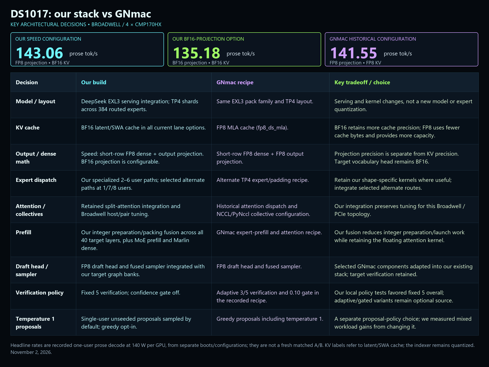

# Tentative speed and quality leaders - November 2, 2026

We extended our optimized DeepSeek serving stack with prefill fusion across all 40 target layers, faster target execution and integrated draft sampling, while preserving our specialized expert shapes, split attention and communication paths. We compared FP8 and BF16 output projection with BF16 KV, measuring decode speed, full request wall time and perplexity.

Special thanks to [GNmac](https://github.com/GNmac-lab/deepseek-v41-flash-1017-cmp170hx) for the FP8 and draft-sampling work adapted in this update; see the [existing attribution document](../../NOTICE.md).

### Tentative speed winner: earlier FP8 output-projection integration

| Configuration | Count tok/s | Code tok/s | Prose tok/s | Prose full wall s |
| --- | --- | --- | --- | --- |
| Tentative speed leader: earlier FP8 output projection | 277.97 | 248.87 | 143.06 | 3.0519 |
| BF16 output-projection option: latest confirmation | 262.38 | 238.05 | 135.18 | 3.1943 |
| Tentative quality leader: original target, latest confirmation | 223.15 | 200.61 | 115.28 | 3.7765 |

These are one-user Morrow streaming rates at 140 W and 400 generated tokens, with full request wall shown for prose. Streaming excludes time to first token; wall includes it. The earlier speed configuration is the median of three batches in a prior boot; the latest confirmation is a different boot, with three batches/cell and bracketing original controls. **These rows are not a matched projection-only ablation.** The full 143-to-135 tok/s difference has not been isolated. A later single-pass control reached 149.54 prose tok/s; that is retained as a one-pass observation, not substituted for the repeated headline. See the [earlier speed measurements](https://github.com/CurtisAccelerate/DeepSeekv41-Flash-1017-EXL3-CMP170HX/blob/main/benchmarks/2026-11-01/MORROW-PREVIOUS-FULL.csv).

### Tentative quality winner: original target in the latest matched fixture

| Latest same-boot quality fixture | Overall PPL | Short PPL | Long PPL | Critical-token NLL |
| --- | --- | --- | --- | --- |
| Tentative quality leader: original target | 1.166442374 | 1.169831946 | 1.163062623 | 0.084313206 |
| BF16 output-projection option | 1.168603909 | 1.171285248 | 1.165928709 | 0.087338365 |

**Lower perplexity (PPL) and NLL are better.** The original is the numerical leader in this latest fixture; the 135 tok/s BF16-projection option is not its quality winner. Its overall PPL is about 0.19% higher than original. Delta NLL 0.00185139 is smaller than the original 0.00222921 and BF16-option 0.00203648 repeat spreads, so this does not establish a reliable general accuracy difference or equivalence. All 48 correct-vs-incorrect likelihood contrasts preferred the correct answer. These are 96 teacher requests on six synthetic investigation states at roughly 0.4K/7.3K, not an agent-success or 128K quality test.

An **earlier matched target-isolation** screen instead favored BF16 projection: overall PPL 1.165453 versus 1.170190 for FP8 projection (original 1.168664). That was the limited evidence motivating the conservative recipe. It used the original drafter and is a different experiment: **do not assign those PPL scores to the complete 143/135 tok/s recipes or combine them into a matched frontier.** The earlier prose wall cost of BF16 projection was about 2.6%; it does not explain the entire cross-boot speed difference. No fully matched quality comparison of the complete earlier 143 tok/s recipe against the latest 135 tok/s recipe is available.

**Reader choice:** the earlier FP8-projection integration is the tentative repeated single-user speed leader; the original target is the tentative latest-fixture quality leader; the 135 tok/s BF16-projection integration is a precision-conservative alternative with a different speed/likelihood tradeoff. Quality rankings vary by run and metric. Existing snapshot filenames and the packaged client/image record the BF16-projection option; they do not establish it as the best choice for every user. The new speed-default Docker can prepare the speed or BF16-projection bank using an explicit lane setting. Switching projection banks requires a cold load and the retained all-rank qualification; the earlier143tok/s figure has not been remeasured on this packaging.

## Final Morrow: decode and actual wall time

Both configurations run on the same BF16-cache boot, four CMP170HX cards at 140W, temperature zero. Original means our original optimized target/drafter/reference prefill; balanced adds the selected integration above. Original frozen protocol hash is `bad399f0b6134a46c25fe1db119d07550fd19e66f756e61404b8038deb1ec87f`.

972 measured requests plus 324 separate complete first-use requests; three batches/cell, with original controls bracketing one balanced pass. Each request emits 400 tokens, actual cache usage is zero. All requested concurrency graphs were observed on every rank; no eligible shape fell back because its graph was missing. Streaming rates are per user, exclude TTFT, use `(tokens-1)/(last-first arrival)`, then median three batches. Original numbers average its two pass medians. Wall is whole-batch send-to-close span, including TTFT. These are descriptive repeats, not confidence intervals or identical-content guarantees.

| Users | Prompt | Original tok/s | Balanced tok/s | Original wall s | Balanced wall s | Wall cut | Original TTFT s | Balanced TTFT s |
| --- | --- | --- | --- | --- | --- | --- | --- | --- |
| 1 | count | 223.15 | 262.38 | 2.1134 | 1.7611 | +16.67% | 0.3247 | 0.2393 |
| 1 | code | 200.61 | 238.05 | 2.2958 | 1.8899 | +17.68% | 0.3056 | 0.2123 |
| 1 | prose | 115.28 | 135.18 | 3.7765 | 3.1943 | +15.42% | 0.3153 | 0.2348 |
| 2 | count | 175.23 | 190.84 | 2.6965 | 2.3031 | +14.59% | 0.3918 | 0.2145 |
| 2 | code | 160.02 | 172.87 | 2.8161 | 2.5298 | +10.17% | 0.3627 | 0.2256 |
| 2 | prose | 81.23 | 87.32 | 5.3593 | 4.7994 | +10.45% | 0.3969 | 0.2188 |
| 3 | count | 144.85 | 150.13 | 3.2980 | 3.0771 | +6.70% | 0.3940 | 0.4686 |
| 3 | code | 132.55 | 124.06 | 3.4831 | 3.6432 | -4.60% | 0.3668 | 0.4462 |
| 3 | prose | 69.02 | 71.43 | 6.4570 | 6.1010 | +5.51% | 0.5621 | 0.4746 |
| 4 | count | 128.19 | 133.40 | 3.6432 | 3.4327 | +5.78% | 0.5129 | 0.4747 |
| 4 | code | 122.11 | 134.41 | 3.7466 | 3.1979 | +14.65% | 0.3475 | 0.2274 |
| 4 | prose | 58.47 | 57.95 | 7.5697 | 7.4788 | +1.20% | 0.6498 | 0.4790 |
| 5 | count | 115.68 | 118.64 | 4.0175 | 3.8222 | +4.86% | 0.6033 | 0.4835 |
| 5 | code | 100.44 | 102.57 | 4.4923 | 4.3530 | +3.10% | 0.4985 | 0.4543 |
| 5 | prose | 52.03 | 53.05 | 8.4322 | 8.2889 | +1.70% | 0.6549 | 0.4843 |
| 6 | count | 103.72 | 107.36 | 4.5164 | 4.2056 | +6.88% | 0.7103 | 0.5088 |
| 6 | code | 86.59 | 88.84 | 5.5353 | 5.1172 | +7.55% | 0.7845 | 0.4789 |
| 6 | prose | 47.03 | 47.66 | 9.5021 | 9.1272 | +3.95% | 0.7704 | 0.5058 |
| 7 | count | 77.90 | 87.95 | 5.8198 | 5.0373 | +13.44% | 0.7625 | 0.5150 |
| 7 | code | 70.49 | 80.96 | 6.4569 | 5.4504 | +15.59% | 0.8075 | 0.4951 |
| 7 | prose | 37.65 | 43.50 | 11.6124 | 9.9351 | +14.44% | 0.7759 | 0.5087 |
| 8 | count | 87.48 | 97.35 | 5.2888 | 4.5958 | +13.10% | 0.7691 | 0.5103 |
| 8 | code | 74.72 | 84.70 | 6.3977 | 5.4223 | +15.25% | 0.8433 | 0.5214 |
| 8 | prose | 39.49 | 45.26 | 11.2018 | 9.5752 | +14.52% | 0.7904 | 0.5118 |

The fresh regression is three-user code: balanced wall is 4.60% slower. Earlier full target isolation also recorded other middle-concurrency regressions; they remain in the historical evidence. First-use results are preserved separately rather than discarded as outliers.

Historical standalone GNmac single-user streaming was 263.09 count / 235.61 code / 141.55 prose tok/s. Those were another boot with FP8 KV and incompletely attested cache usage. Current balanced is 262.38 / 238.05 / 135.18. This does not establish a universal win over GNmac. Do not combine the best cells from different boots into a synthetic winner.

## Cold prefill through 128K

One frozen cache-zero request/cell per configuration, same exact normalized request and actual input token count, one generated token. This is a bounded whole-stack confirmation; the earlier 30-request fusion-isolation study remains separate. Tokens/wall includes the request and one-token completion overhead, not a pure GPU-only prefill timer.

| Target | Actual input tokens | Original wall s | Balanced wall s | Balanced TTFT s | Balanced input tok/s | Wall cut |
| --- | --- | --- | --- | --- | --- | --- |
| 2048 | 2032 | 1.3654 | 1.1687 | 1.1684 | 1738.7 | 14.41% |
| 8192 | 8180 | 5.1925 | 4.6699 | 4.6696 | 1751.7 | 10.07% |
| 32768 | 32782 | 21.6024 | 19.3293 | 19.3289 | 1696.0 | 10.52% |
| 131072 | 131088 | 95.3797 | 87.4799 | 87.4796 | 1498.5 | 8.28% |

Earlier full integer fusion isolated against the MoE-only prefill baseline cut 128K wall from 91.585 to 87.615 seconds (4.34%). Fresh balanced is 87.480 seconds. Historical GNmac was 86.333 seconds, with FP8 KV, different calibrated input lengths and another boot; the remaining difference is not isolated to cache precision. BF16 cache uses roughly twice the cache bytes, reduces capacity for the same pool, and can cost bandwidth. It was never established as free or as the sole source of GNmac quality changes.

The fusion replaces repeated integer row/index preparation and packing with a direct pass across 20 ratio-1, 18 ratio-2 and two sliding-window target layers. It retains the same floating attention and invalid-slot/order/bounds semantics. Startup checked 85 integer and nine same-attention cases per rank; actual all-40-layer hits were observed. The GNmac short-row linears do not explain bulk long-prefill speed when row thresholds bypass them. Expert-prefill scheduling/backend and integer preparation are separate measured changes. Faster streaming alone did not remove earlier cold-code or seeded-pause regressions.

## Bounded SPARK temperature one

396 measured requests, users 1/2/8, two reverse-ordered passes per configuration, original eight categories plus a separately retained counting ceiling. The table is the mean of two pass means of the eight category full-wall aggregate rates; ceiling excluded. It is not suite-total tokens divided by suite-total time. Per-user decode uses the original SPARK `(tokens-1)/(close-first)` rule, which differs from Morrow's last-token rule.

Balanced in this particular comparison explicitly requests greedy proposals. At one user this differs from the packaged BF16 option's existing sampled-proposal split; at multiuser the existing split is already greedy. Label these as optional-proposal results, not packaged single-user performance. Target temperature remains one. Actual output lengths and content vary, so these rates do not establish equal-work wall reductions or quality improvement.

| Users | Original aggregate tok/s | Balanced + optional greedy tok/s | Rate change | Original per-user decode | Balanced per-user decode | Original TTFT s | Balanced TTFT s |
| --- | --- | --- | --- | --- | --- | --- | --- |
| 1 | 94.20 | 123.11 | +30.68% | 120.83 | 151.86 | 0.3090 | 0.2066 |
| 2 | 126.11 | 143.56 | +13.84% | 84.76 | 90.66 | 0.4804 | 0.3314 |
| 8 | 257.34 | 299.65 | +16.44% | 45.65 | 50.30 | 0.8722 | 0.5806 |

All-rank target/proposal/q paths, response identities, source identity, cache-zero usage, request hashes and actual arrival timings were independently checked. The offline checker initially incorrectly expected an R1 DraftPlan for multiuser; pinned code returns none and uses the captured greedy sampler. The corrected checker requires that actual sampler on all ranks and correct absent-q residual path. The original checker failure remains preserved; no GPU tests were rerun.

Four eight-user summarization requests had visible content gaps above one second: balanced 1.056/1.076 seconds, original 1.303/1.258 seconds. They remain in timing and raw data. These are local client arrival gaps, not proof of Hermes buffering or GPU-token timing. Earlier short single-user probes had no such large gaps; that does not invalidate these multiuser observations.

## Quality: which ranked best

The original ranks numerically best in the fresh matched fixture. Lower perplexity (PPL) and negative log likelihood (NLL) mean higher probability assigned to the frozen correct continuation. PPL is exp(mean NLL); neither metric is a percentage of successful agent tasks.

96 teacher requests: two passes/configuration, six synthetic investigation states, short roughly 0.4K and long roughly 7.3K histories, 138 gold tokens/pass. Teacher forcing bypasses proposal generation and greedy-head shortcut. It does not test 128K quality, sampled-distribution identity or agent success.

| History | Original PPL | Balanced PPL | Original critical NLL | Balanced critical NLL |
| --- | --- | --- | --- | --- |
| short | 1.169831946 | 1.171285248 | 0.075348191 | 0.081772763 |
| long | 1.163062623 | 1.165928709 | 0.093278221 | 0.092903966 |
| all | 1.166442374 | 1.168603909 | 0.084313206 | 0.087338365 |

Balanced overall PPL is 0.1853% higher; delta mean NLL is +0.00185139 nats, smaller than original repeat spread 0.00222921 and balanced spread 0.00203648. This gives no reliable accuracy-gain or equivalence conclusion. Short critical loss is worse by 0.00642457; original short-critical repeat spread is 0.01014933. Retain this sensitivity rather than hiding it behind the overall result. Balanced long-critical loss is slightly lower.

All 48 correct-vs-incorrect likelihood contrasts preferred the correct answer. One balanced pass changed a JSON separator token away from the frozen answer and the next `read` token toward it; the other balanced pass and closing original had no winner changes relative to opening original. A winner change means argmax differs at that frozen prefix. Its direction describes agreement with that one answer, not a measured successful/failed free-generated tool call. In particular, the separator mismatch is not a changed file path or proof of malformed JSON.

Earlier independent screens sometimes ranked balanced first; those rankings varied within repeat noise. The fresh result above takes precedence for the latest table. BF16 KV/output projection removes two specific approximations but leaves quantized experts and selected dense FP8 math. A controlled earlier cache-only fixture favored BF16 (PPL1.16859 vs FP81.18368), not proof of a universal accuracy ordering among whole builds.

## We tested GNmac drafting, not just its kernels

All 16 local full-cycle costs (users1..8, widths3/5) were measured on the qualified integration; cheaper narrow cycles are not automatically more output tokens per second. All 4,585 actual adaptive choices replayed exactly against GNmac's pinned controller (prior0.9, strength2, decay0.9, hysteresis0.03). Its unweighted 12-cell wall improvement was only 0.37%; fixed-three regressed 13.96% and confidence gating regressed1.25% overall in that descriptive screen. Adaptive improved some prose cells but slowed count at all tested levels. Fixed-five/gate-off therefore remains selected. All original specialization binaries retain their pins; new rows4/16/20/28/32 use separately compiled libraries and 96 actual-weight retained/new-row parity cases/rank. Narrow sampled admission remains blocked; the later narrow quality stop remains preserved.

The separate same-target single-user temperature-one proposal screen used 72 measured requests plus18 warmups and16 seed controls, with original SPARK categories and equal400-token controls. Greedy fast proposals cut count wall4.42% and prose7.81% but made code3.01% slower; sum of three equal-length control walls fell3.99%. These are two-pass descriptive results. The override remains explicit opt-in, not a blanket default gain. Exact seeded output identity failed, and prose variation also appeared in flag-off repeats; the failure was not relabeled passed.

In ideal speculative sampling, changing only the proposal can preserve the target distribution: a deterministic proposal d has q(d)=1, is accepted with p(d), and rejection samples p excluding d. The actual retained rejection code follows that branch. This source/analytic audit plus real q-path observations is not proof of GPU/RNG independence or general quality. See [Leviathan et al., ICML2023](https://proceedings.mlr.press/v202/leviathan23a.html).

## What explains the gains and what stays ours

The early target-component removal tests identified the alternate one-user expert path as the largest observed target contribution: restoring the original experts lost roughly13–16% wall relative to the combined path. Dense and output-projection removals each cost roughly3–7% in that screen; their effects are not additive. Apparent differences when the requested expert route was identical were retained as negative controls, not assigned to expert arithmetic. The full follow-up captures all users1..8 so shrinking batches do not silently erase the measured integration.

Our optimized expert shapes at users2..6, original pinned six-row/cooperative binaries, split attention, collective routes and Engram work remain. The integration selects alternate expert paths at1/7/8 rather than replacing every shape. It does not adopt the 96-whole-experts-per-rank layout. BF16 output projection trades a small measured cost against full-import FP8 projection; the final policy avoids a wholesale port. Prefill uses the separately qualified expert operator plus our full integer preparation fusion, with Marlin dense and existing floating attention.

## Reproducibility, packaged recipe and boundaries

The source/default client is in the companion [kernel repository](https://github.com/CurtisAccelerate/DeepSeekv41-Flash-EXL3-TC-MoE/tree/main/experiments/ds1017-bf16-full-fusion). The supported client explicitly selects the measured profile through the existing qualified private control protocol; it does not invent a production env flag. Existing ordinary launch commands and old production-control paths are not silently repointed. The model remains private; no Hermes change. An actual400-token client smoke observed the selected target graph on all four ranks.

Qualified runtime base:`sha256:7ecbcf725f31d1b5bc05fc6863a16a94ef9c1c6cf7441e0a5c257fcd430e4d94`.
Effective source/native identity:`738ae435bf007ca27df22f43254c92903f4f9cb2ac3b6e67171a0f556be01877`.
Tested source archive SHA256:`30eb1891e5f36b80d775412a4578d6c1705e80e27f4651585e23b3129e33292b`.
Final private raw archive SHA256:`b726a8327304b182a9f6f9e4111c6d77f21b62aa8b5eee6ada87366d7210bc47`;431 members rehashed on server and locally. Private raw launch paths/endpoints are excluded from public publication; request/body/content/source hashes and sanitized numerical tables are included. Native/image pins, preserved failure logs and exact executed code remain in that internal archive. A versioned derivative Docker artifact packages the identical qualified runtime with the selected recipe and runs CPU/native/source checks; a fresh GPU boot of that packaging layer is not claimed.

All measurements retain140W limits, thermal protections,1152MiB capture cap,1GiB startup free-memory floor and one GPU job at a time. The first narrow-graph load failed the retained-memory floor and was preserved; serialized scratch pooling with retained-output ownership tests corrected it without reducing the floor. Startup passed32 sampler interleave cases/rank in addition to existing gates. CPU tests are not GPU qualification; both scopes are recorded separately.

## Attribution and licenses

Special thanks to [GNmac](https://github.com/GNmac-lab/deepseek-v41-flash-1017-cmp170hx) for the FP8 target/draft kernels, fused sampler, alternate expert recipe and adaptive controller adapted and tested here. The [existing attribution document](../../NOTICE.md) records the source lineage and licenses.

Morrowmake supplies foundational tensor-core MoE/prefill and adaptive-depth work; ExLlamaV3/Turboderp supplies expert/codec foundations; vLLM and its named ROCm/SM80 attention contributors retain their notices. CurtisAccelerate contributes the retained specialized shapes, serving integration, integer fusion, finite capture/ownership/admission guards, local calibration, component isolation and measured validation described here. See the kernel NOTICE for exact component/commit boundaries. No model weights or private credentials are redistributed.

The archived BF16-only packaging is `star-ds1017:2026.11.02-balanced-k5`, immutable `sha256:16d47d8d6059f8d4abfa159268bc9f3d65f9fc3b65311a481cd15991c572ee7c`. Its [build receipt](BF16-DOCKER-BUILD-VERIFIED-20261102.json) and [snapshot](BF16-DEFAULT-SNAPSHOT-20261102.json) remain preserved. The new speed-default public image is a separate artifact, linked below.

## Speed-default Docker settings

The user-selected Docker default is now `speed` (FP8 output projection with BF16 KV), with `bf16` and original-target `quality` presets. This changes the packaged default, not the historical benchmark or likelihood measurements above. See the [settings guide](https://github.com/CurtisAccelerate/DeepSeekv41-Flash-EXL3-TC-MoE/blob/main/experiments/ds1017-bf16-full-fusion/release/speed-default/README.md). The former BF16-only image/snapshot remains an archived artifact.

[Download Docker](https://github.com/CurtisAccelerate/DeepSeekv41-Flash-1017-EXL3-CMP170HX/releases/tag/2026.11.02-speed-k5) · [Build and validation receipt](PUBLIC-IMAGE-VERIFIED.json) · [Current default snapshot](DEFAULT-SNAPSHOT.json) · [Architecture and tradeoffs](BUILD-DECISIONS-OURS-VS-GNMAC.png).

The public image is distributed as a checksum-verified split Docker archive. It defaults to speed, with BF16 projection and original-target quality settings. It excludes model weights and private build history. CPU/source/native/settings checks passed; a fresh GPU cold boot of this packaging is not claimed. The headline speeds are earlier measurements of the corresponding recipe families.

## Architecture and tradeoffs

[Text version](BUILD-DECISIONS-OURS-VS-GNMAC.md). Only confirmed decisions are included. The headline rates are separate-boot historical measurements, not a fresh matched comparison with GNmac.
